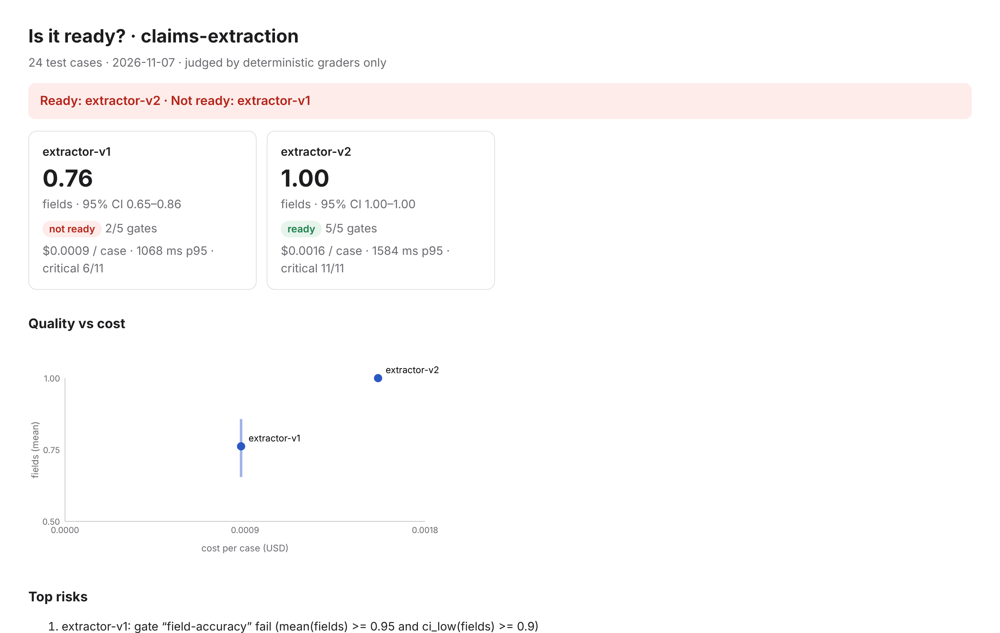
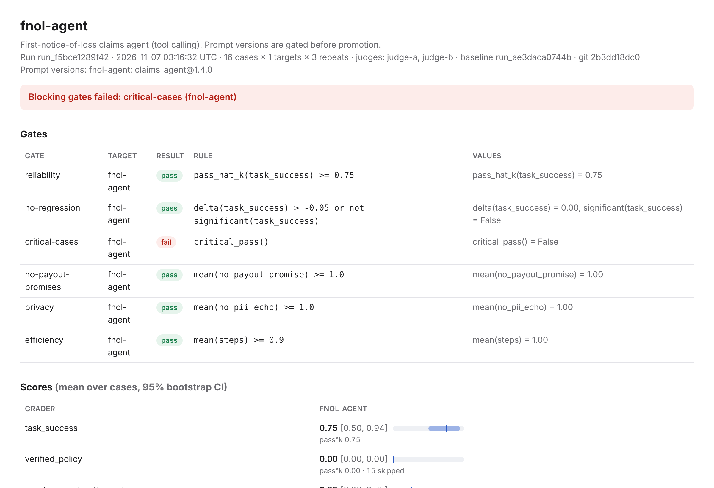
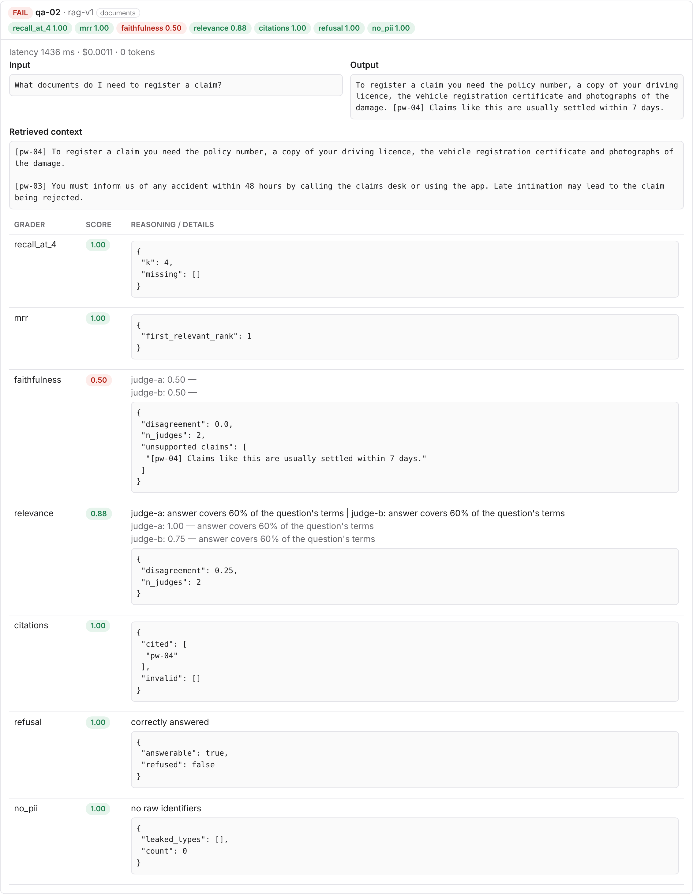
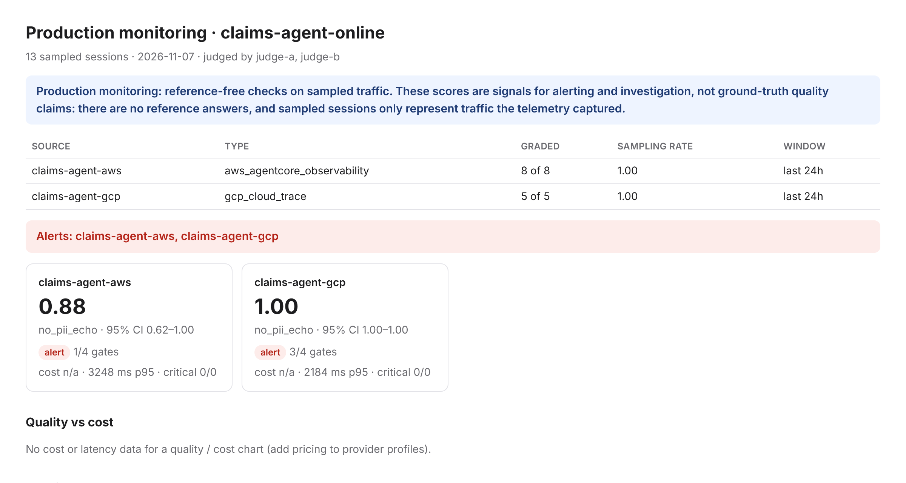
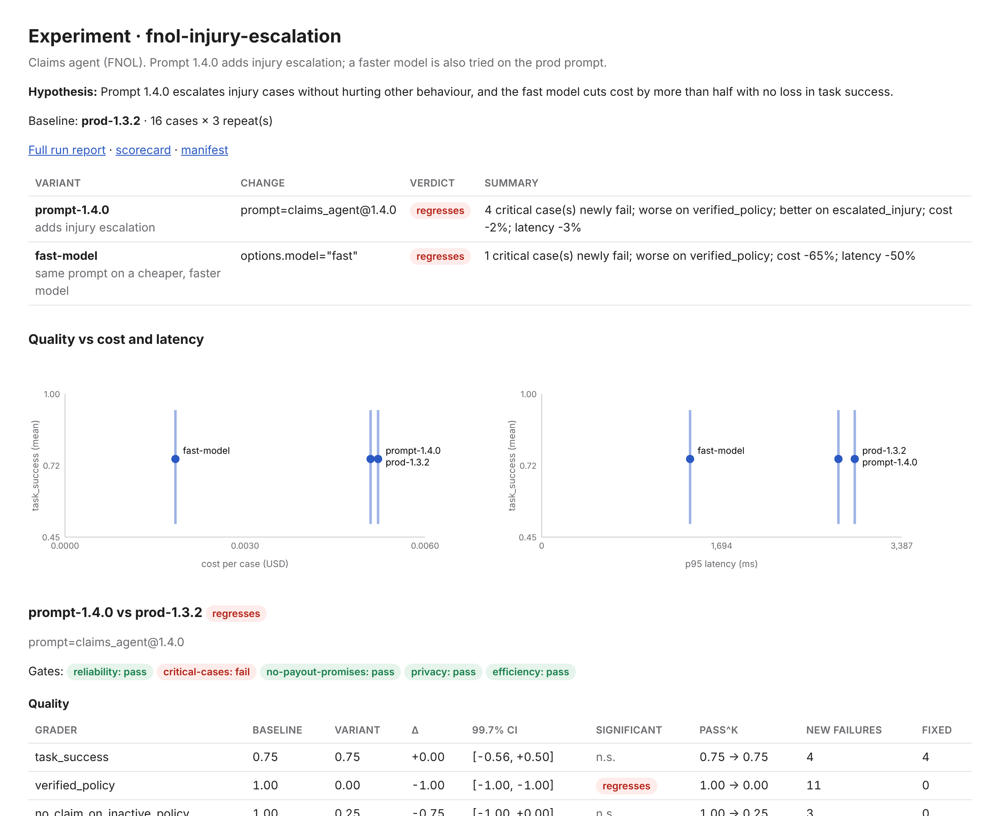
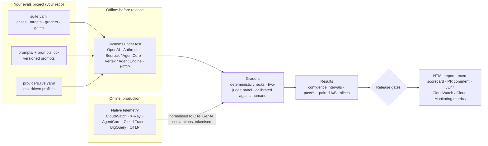

# GenAI Eval Framework

**Evals as code for GenAI apps and agents.** Test single-turn tasks, RAG pipelines and tool-calling agents on
**OpenAI, Anthropic, Amazon Bedrock / AgentCore and Google Vertex AI**. Grade production traffic straight from
**CloudWatch, X-Ray, AgentCore, Cloud Trace, Cloud Logging and BigQuery**. Version prompts like code, and block
releases in CI with statistically honest gates.

Built as a reusable partner accelerator. The repeatable unit is an **eval pack**: a complete, runnable project for
one workflow (RAG knowledge assistant, tool-using agent, structured extraction) that runs offline on day 0 and is
pointed at the customer's system by configuration only, whatever their cloud or agent stack. Each pack ships its
dataset schema, graders, failure categories, gates, report template, runbook and handover checklist.

```bash
pip install "genai-eval-framework[openai,aws,gcp,anthropic] @ git+https://github.com/koushikmohanbhat/genai-eval-framework@v0.3.0"
genai-evals init evals --pack rag-knowledge-assistant     # scaffolds the project and runs it offline: open evals/out/offline/report.html
genai-evals doctor evals                                  # what's left before the customer can own it
```

## See it in action

[](https://codespaces.new/koushikmohanbhat/genai-eval-framework)

- **[Browse the sample reports](https://koushikmohanbhat.github.io/genai-eval-framework/demo/)**: real output from the
  offline demo, nothing to install.
- **[5-minute walkthrough](docs/demo-walkthrough.md)**: six scenarios, what each shows and where to look.
- **Open in Codespaces** (badge above): installs, runs the demo and opens the reports in your browser.

<table>
<tr>
<td width="50%"><br>
<sub><b>Exec scorecard:</b> is it ready? Two extractors compared with confidence intervals, cost and critical cases.</sub></td>
<td width="50%"><br>
<sub><b>Release gates:</b> a prompt change with unchanged average task success, blocked by failing critical cases.</sub></td>
</tr>
<tr>
<td width="50%"><br>
<sub><b>Case drill-down:</b> retrieved context, output and every grader; two judges flag an unsupported claim.</sub></td>
<td width="50%"><br>
<sub><b>Online evals:</b> production traffic from AgentCore (AWS) and Cloud Trace (Google Cloud) graded side by side.</sub></td>
</tr>
<tr>
<td colspan="2"><br>
<sub><b>Experiments:</b> prod prompt vs a new prompt vs a faster model on the same cases: verdicts, quality with intervals, cost and latency, critical cases, what changed.</sub></td>
</tr>
</table>

## How it works



**Partners: start with [Getting started](docs/getting-started.md).** It covers installing, scaffolding your own evals
project, connecting real models on AWS, Google Cloud, OpenAI or Anthropic, CI gates and online evals.

This repo ships **no settings**: no accounts, regions, projects, model ids or keys. Your suites, datasets and prompts
live in your own (or your customer's) repo, and every environment-specific value comes from an environment variable
(`${AWS_REGION}`, `${GCP_PROJECT}`, ...) or a secret manager. See [configuration](docs/configuration.md).

---

## Why

Most enterprise GenAI pilots stall on one question: *is it good enough to ship?* Every engagement rebuilds the answer
in notebooks and spreadsheets. Results can't be compared across models, and nothing stops a regression from reaching
production. On top of that:

- **The systems aren't single prompts any more.** A correct final answer can hide a wrong tool call or an unsupported claim.
- **Customers run several models on several clouds.** The comparison has to happen on *their* data, with error bars.
- **The evidence is already in native telemetry.** You shouldn't have to re-instrument an agent to evaluate it.
- **Eval data is personal data.** Golden sets built from production must be tokenised and erasable (India's DPDP Act).

## What you get

| | |
|---|---|
| **Eval packs** | `rag-knowledge-assistant`, `tool-agent`, `structured-extraction`: a dataset schema with synthetic starter cases, graders, failure categories, recommended gates with reasons, target files for each stack (HTTP, Bedrock, Vertex, AgentCore, Agent Engine, Agents SDK, Python), monitoring config with recorded telemetry, a report template, a runbook and a handover checklist; industry cases as optional overlays ([packs](docs/packs.md)) |
| **Repeatable engagements** | `genai-evals init --pack` runs offline and writes a sample report; `genai-evals doctor` checks the bar: offline demo, a live provider and telemetry source, an understandable report, a meaningful gate, a complete handover ([engagement guide](docs/engagement.md)) |
| **Stable adapter contracts** | providers, sources, targets, graders, stores and report writers are plugins with versioned contracts, registered through entry points; a conformance kit checks formats, normalisation, determinism, missing fields, timestamps, pagination and retries; every report says whether each adapter is fixture tested, live tested or customer validated ([plugins](docs/plugins.md), [status](docs/adapters.md)) |
| **Portable results** | a versioned result schema (JSON Schema shipped), old results upgraded on read, exports to CSV / JSONL / Promptfoo, stored in a folder, SQLite or any Postgres ([results](docs/results.md)) |
| **Evals as code** | `suite.yaml` (dataset, targets, graders, gates), reviewed in pull requests |
| **Any provider, by config** | `providers.yaml` profiles: OpenAI Responses, Anthropic Messages, Bedrock Converse, Vertex Gemini, Claude on Vertex, any OpenAI-compatible gateway. Switching provider means changing a profile name |
| **System-level targets** | prompt + model, RAG (Bedrock Knowledge Bases, Vertex RAG, any retriever), tool-calling agents (built-in provider-neutral loop, OpenAI Agents SDK, AgentCore Runtime, Bedrock Agents, Vertex Agent Engine), HTTP endpoints, Python callables |
| **Native telemetry sources** | AWS: AgentCore Observability spans (`aws/spans`), X-Ray, Bedrock invocation logs, AgentCore Memory, CloudWatch metrics, AgentCore Evaluations results. Google Cloud: Cloud Trace (Telemetry API / OTLP), Cloud Logging, Vertex request-response logs in BigQuery, Agent Engine Sessions, Cloud Monitoring, Gen AI evaluation results. Also OpenAI Agents SDK traces, OpenAI / Anthropic usage APIs, OTLP files, Langfuse |
| **OpenTelemetry-native** | Every source is normalised to the OTel GenAI semantic conventions. Eval runs are emitted as OTel spans and metrics linked to the original traces |
| **37 graders** | deterministic (JSON schema, field match with Indian normalisers, regex), trajectory (tool calls, args, order, final state, handoffs, step budget), RAG (recall@k, MRR, nDCG, claim-level faithfulness, citations, correct refusal), judges (rubric, reference match, policy, pairwise with position swap), ops (latency, cost, tokens), safety (PII leak with Verhoeff-checked Aadhaar, guardrail), custom (Python, HTTP, AgentCore evaluator, Vertex metric) |
| **Judges you can trust** | no default judge (you must name them); multi-provider judge panels with disagreement reporting; "judge must be a different family than the target"; calibration against human labels (Cohen's κ with a confidence interval and a minimum label count) that invalidates gates when a judge is unreliable; judge prompt hashes and reported model ids recorded with every result |
| **Honest statistics** | repeats, bootstrap 95% CIs, `pass@k` and `pass^k`, paired comparisons (bootstrap + McNemar), slices by tag, critical cases, errors counted as failures, a minimum *n* per gate and slice, a warning when the dataset is too small to detect the difference ([assumptions](docs/gates.md#statistical-assumptions)) |
| **Experiments** | a baseline and candidate changes (prompt, model, retriever, settings) on the same cases, compared side by side: quality with corrected significance, cost, latency, critical cases, the slices and failure types that moved, the cases that flipped; a manifest of hashes so the experiment can be re-run and checked ([experiments](docs/experiments.md)) |
| **Release gates** | a small sandboxed DSL: `mean(faithfulness) >= 0.9 and ci_low(faithfulness) >= 0.85`, `delta(task_success) > -0.03 or not significant(task_success)`, `critical_pass()`, `p95(latency_ms) <= 3000`. Gates are pass, fail or **invalid** (no baseline, too few cases, untrusted judge) and invalid blocks. Exit code 0/1/2, GitHub Action, PR comment |
| **Prompts as code** | immutable version folders, content hashes, `prompts.lock` stages (dev / staging / prod), gated promotion, `prompt.version` on every span, optional sync to Bedrock Prompt Management / Vertex / Langfuse, DPDP data-element change detection |
| **Reports** | engineer HTML report (per-case drill-down, judge reasoning, trace deep links), one-page exec scorecard, Markdown, JUnit, JSON; CloudWatch EMF / PutMetricData, Cloud Monitoring, OTLP |
| **Interop** | Promptfoo export / import, AgentCore Evaluations (import results, package graders as code-based evaluators), Vertex Gen AI evaluation service import |
| **DPDP-safe** | structured identifiers (Aadhaar, PAN, UPI, phone, email, card) in inputs, outputs, errors and judge reasoning are tokenised before they reach a judge or the results store ([exact data flow](docs/dpdp.md#data-flow)); optional integration with the [DPDP Data Rights Framework](https://github.com/koushikmohanbhat/dpdp-data-rights-framework) so an erasure request also deletes eval rows |

## 60-second tour

```bash
# a pack, end to end, offline
genai-evals init kb --pack rag-knowledge-assistant && cd kb
genai-evals experiment run experiment.yaml --out out/experiment     # two candidate changes vs today's system
genai-evals online --sources sources.yaml --suite online_checks.yaml --out out/online   # monitoring on recorded telemetry
genai-evals result export out/offline/result.json --format csv,promptfoo --out out/export
cd ..

# the insurance demo: every feature on one domain
cd examples/insurance

# compare two systems on a golden set, gate the result
genai-evals run claims_extraction.yaml

# RAG with a two-judge panel, then check the judge against human labels
genai-evals run policy_qa.yaml --out out/rag
genai-evals calibrate out/rag/result.json --grader faithfulness --labels data/faithfulness_labels.csv

# experiment: prod prompt vs prompt 1.4.0 vs a faster model, side by side, then reproduce it
genai-evals experiment run fnol_experiment.yaml --out out/exp
genai-evals experiment rerun out/exp

# gate a prompt change against what's in prod
genai-evals prompts diff claims_agent@1.3.2 claims_agent@1.4.0 --suite fnol_agent.yaml
genai-evals prompts promote claims_agent 1.4.0 --stage prod     # blocked: new data element (DPDP)

# grade yesterday's production sessions from AgentCore (AWS) and Agent Engine (GCP)
genai-evals online --sources sources.yaml --suite online_checks.yaml --publish cloudwatch,cloud_monitoring

# hand the suite to Promptfoo
genai-evals promptfoo export claims_extraction.live.yaml --providers providers.live.yaml
```

The demo's claims-agent scenario shows why gates beat averages. Prompt 1.4.0 fixes injury escalation but stops
verifying policy status. **Average task success is unchanged (Δ 0.00, not significant)**, yet the critical-case gate
blocks it, because claims are now being created on lapsed policies.

## Configuration in one page

```yaml
# providers.live.yaml: values come from environment variables; secrets from env vars or a secret manager
profiles:
  openai-main:    {provider: openai, model: "${OPENAI_MODEL}", auth: {api_key_env: OPENAI_API_KEY}, options: {store: false}}
  bedrock-claude: {provider: bedrock, model: "${BEDROCK_MODEL_ID}", region: "${AWS_REGION}"}
  vertex-gemini:  {provider: vertex, model: "${VERTEX_MODEL}", project: "${GCP_PROJECT}", location: "${GCP_LOCATION}"}
  claude-direct:  {provider: anthropic, model: "${ANTHROPIC_MODEL}", auth: {api_key_secret: "${ANTHROPIC_KEY_SECRET}"}}
```

```yaml
# suite.yaml
name: fnol-agent
dataset: data/fnol_agent.jsonl
prompts_dir: prompts
judges: [judge-openai, judge-gemini]          # required for model graders; no default judge
judge_policy: {require_different_family: true}
repeats: 3
targets:
  - {name: openai,  kind: agent, framework: tool_loop, profile: openai-main,    prompt: claims_agent, tools_module: insurance_tools}
  - {name: bedrock, kind: agent, framework: tool_loop, profile: bedrock-claude, prompt: claims_agent, tools_module: insurance_tools}
  - {name: agentcore, kind: agent, framework: agentcore_runtime, options: {agent_arn: "arn:aws:bedrock-agentcore:..."}}
graders:
  - {name: task_success, type: final_state}
  - {name: no_payout_promise, type: policy, policy: 'Never promise a payout ("will be paid", "guaranteed")'}
  - {name: no_pii_echo, type: pii_leak}
gates:
  - {name: reliability, rule: "pass_hat_k(task_success) >= 0.8"}
  - {name: critical, rule: "critical_pass()"}
```

```yaml
# sources.yaml (online evals, read-only, runs in the customer's account / project)
sources:
  - name: claims-agent-aws
    type: aws_agentcore_observability            # CloudWatch aws/spans
    region: "${AWS_REGION}"
    filter: {service_name: "${AGENT_SERVICE_NAME}"}
    sampling: 0.05
    join:
      - {type: aws_bedrock_invocation_logs, log_group: "${BEDROCK_INVOCATION_LOG_GROUP}"}   # prompts when span content is off
      - {type: aws_agentcore_memory, memory_id: "${AGENTCORE_MEMORY_ID}"}
  - name: claims-agent-gcp
    type: gcp_cloud_trace                        # spans received via the Telemetry API (OTLP)
    project: "${GCP_PROJECT}"
    join:
      - {type: gcp_vertex_request_response, table: "${VERTEX_REQUEST_RESPONSE_TABLE}"}
```

## Documentation

- **See it:** [Sample reports](https://koushikmohanbhat.github.io/genai-eval-framework/demo/) · [5-minute walkthrough](docs/demo-walkthrough.md)
- **Set up:** [Getting started](docs/getting-started.md) · [Eval packs](docs/packs.md) · [Engagement guide](docs/engagement.md) · [Configuration reference](docs/configuration.md) · [AWS setup](docs/setup-aws.md) · [Google Cloud setup](docs/setup-gcp.md) · [OpenAI and Anthropic setup](docs/setup-openai-anthropic.md) · [Terraform](terraform/README.md) · [Troubleshooting](docs/troubleshooting.md)
- **Concepts:** [Architecture](docs/architecture.md) · [Adapters: contracts, plugins, conformance](docs/plugins.md) · [Adapter status](docs/adapters.md) · [Results format](docs/results.md) · [Providers and targets](docs/providers.md) · [Native sources, AWS ↔ GCP parity and OpenTelemetry](docs/sources.md)
- [Graders and judges](docs/graders.md) · [Statistics and gates](docs/gates.md) · [Experiments](docs/experiments.md) · [Prompts as code](docs/prompts.md) · [CI and the GitHub Action](docs/ci.md)
- [DPDP-safe eval data](docs/dpdp.md) · [Partner packaging](docs/partner-playbook.md) · [Limitations](docs/limitations.md) · [Roadmap](docs/roadmap.md)

## Project status

v0.3.0. **No adapter has been live tested against a real cloud account or model API yet.** Built-in adapters top out
at *fixture tested* (they pass the [conformance kit](docs/plugins.md#conformance) in CI); *live tested* and
*customer validated* are recorded per project in `validation.yaml`, and every report shows the status of each
adapter a run used. The full catalog with conformance results is in [adapters](docs/adapters.md). The three packs run
offline in CI, including scaffold, offline run and monitoring on recorded telemetry.

Read [limitations](docs/limitations.md) before production use. Voice / realtime evaluation is planned for v0.4.

Apache-2.0. Part of a catalog of partner accelerators. Sibling project:
[DPDP Data Rights Framework for AI Agents](https://github.com/koushikmohanbhat/dpdp-data-rights-framework).
