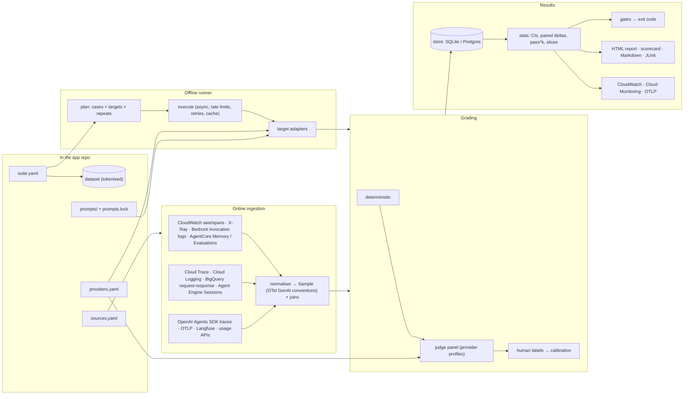

# Architecture

## The one shape: `Sample`

Every target adapter and every telemetry source produces the same `Sample`: input, output (text and parsed JSON),
messages, retrieved `context`, tool-call `trajectory` (tools, handoffs, retrievals), `final_state`, token usage, cost,
latency / TTFT, steps, trace and session ids, and `prompt_versions`. Because of this, a grader written once runs offline on
fresh runs and online on production traffic, on any cloud.

## Run flow

1. **Validate.** The schema is checked, every profile referenced must exist, model graders need explicitly named judges,
   gate rules are parsed and their names resolved, and prompts are checked against `prompts.lock`.
2. **Execute.** Targets run concurrently. Calls go through provider profiles, each with its own concurrency cap, RPM
   spacing and retries on transient errors. Pure targets (prompt / model / RAG) are cached by a content hash of the case,
   the target configuration and the prompt hash, so unchanged cases are not re-run.
3. **Grade.** Deterministic graders run on the raw sample. Model graders send **tokenised** text to the judge panel.
4. **Aggregate.** Per-case means over repeats, bootstrap CIs over cases, pass@k / pass^k, slices by tag, critical cases,
   ops percentiles, and paired deltas against a baseline.
5. **Gate.** Rules are evaluated per target. A blocking failure makes the exit code 1. A gate whose grader's judge fails
   calibration is marked *invalid*.
6. **Store and report.** Samples are tokenised before they are written anywhere. Outputs are HTML, scorecard, Markdown,
   JUnit and JSON, with optional SQL storage, metric publishing and OTel spans.

## Package layout

| Module | Responsibility |
|---|---|
| `config` | Pydantic schemas for providers, suites, sources; static validation |
| `providers/` | OpenAI Responses, OpenAI-compatible, Anthropic (direct / Vertex), Bedrock Converse, Vertex Gemini, mock |
| `targets/` | model / prompt, RAG, HTTP, Python, agents (tool loop, Agents SDK, AgentCore Runtime, Bedrock Agents, Agent Engine), user simulator |
| `graders/` | registry and graders; judge panel |
| `stats`, `gates`, `calibration` | aggregation, DSL, judge agreement |
| `prompts` | prompts as code, runtime `load()`, registry sync |
| `sources/` | connectors, OTel normaliser, joins |
| `online` | production grading pipeline |
| `report/`, `publish`, `otel` | outputs |
| `interop/` | Promptfoo, AgentCore Evaluations, Vertex Gen AI evaluation |
| `dpdp` | tokenisers and DPDP framework integration |
