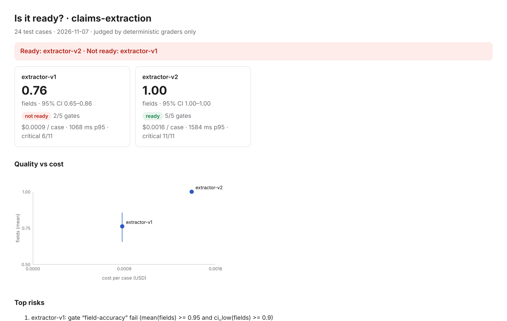
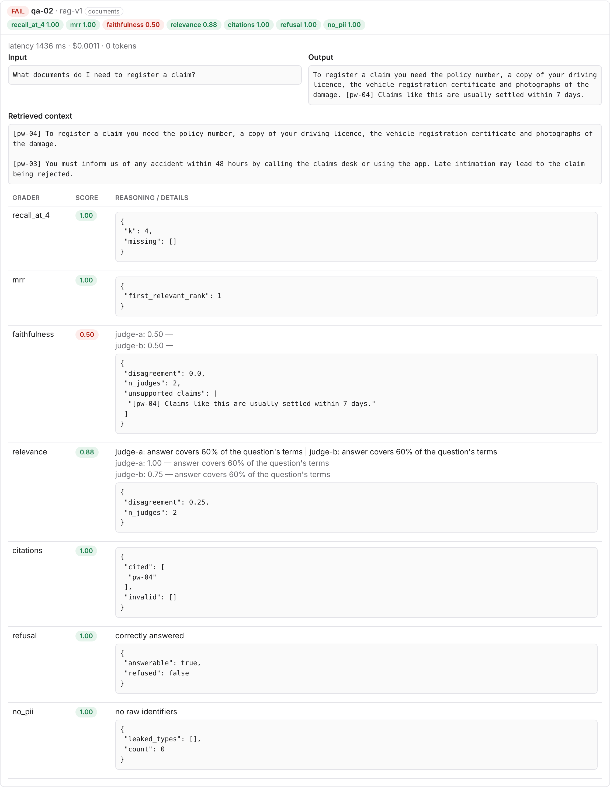
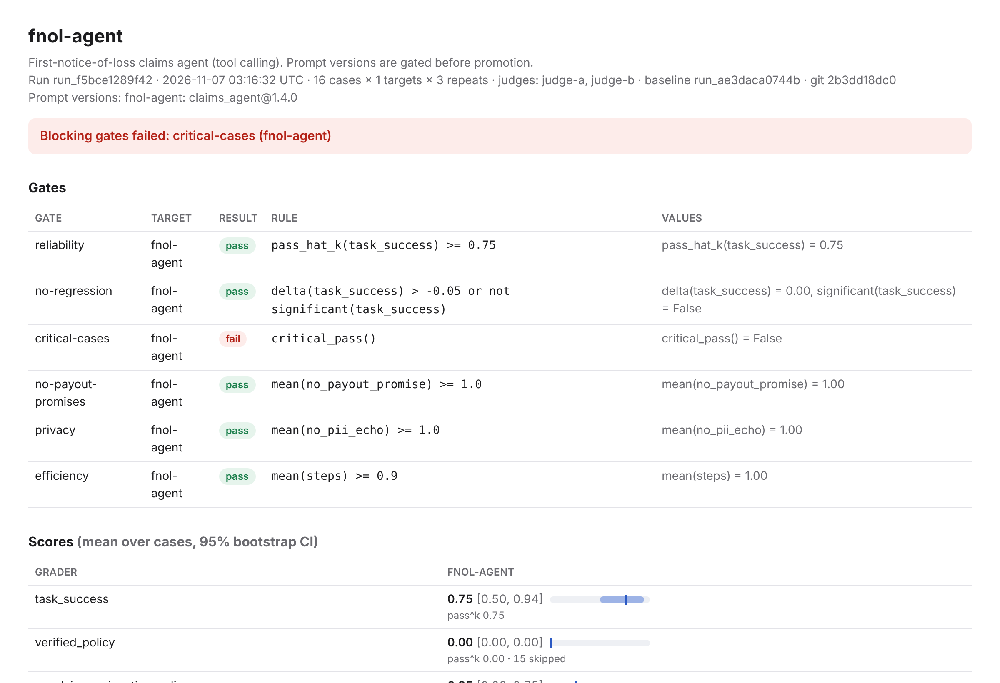
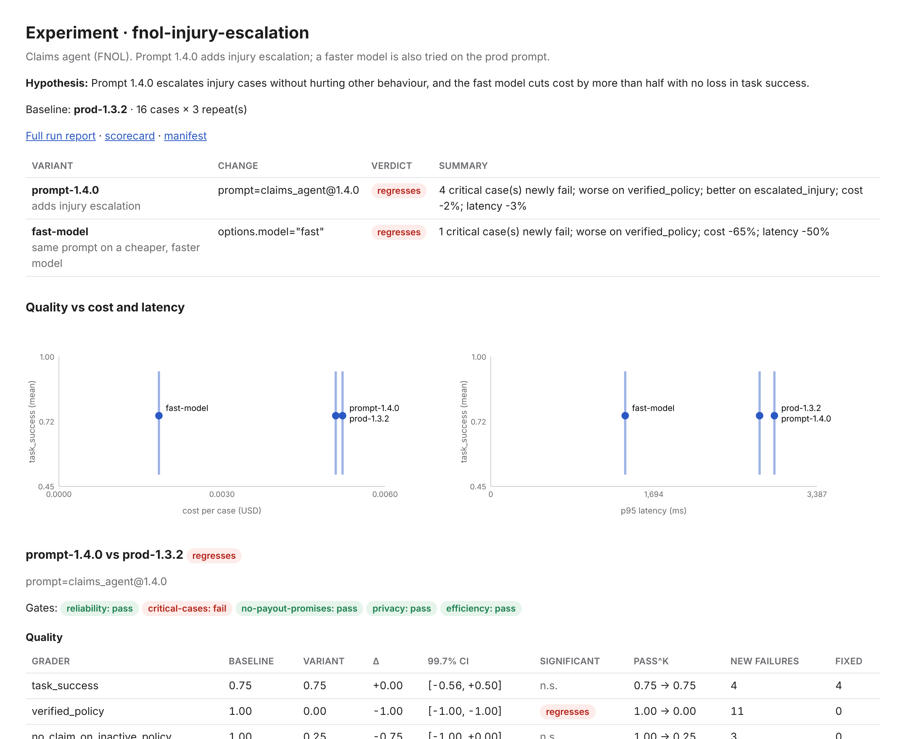
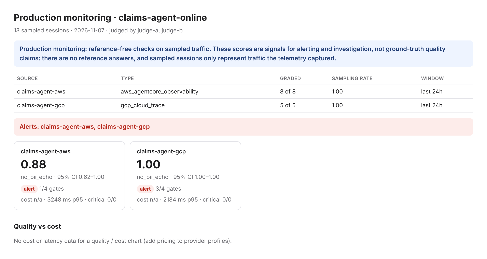

# What you'll see in 5 minutes

The offline insurance demo runs six scenarios end to end with simulated systems and recorded telemetry. There are
no API keys and nothing to configure. Each scenario shows one thing the framework is for.

**Three ways to see it**

| | How | Time |
|---|---|---|
| Browse the output | open the [sample reports](https://koushikmohanbhat.github.io/genai-eval-framework/demo/) | 0 min |
| Run it in the browser | [Open in GitHub Codespaces](https://codespaces.new/koushikmohanbhat/genai-eval-framework): installs, runs the demo and opens the reports on port 8000 | ~2 min |
| Run it locally | `pip install -e ".[dev]" && python examples/insurance/demo.py`, then open `genai-evals-demo/*/report.html` | ~1 min |

The suites, datasets, prompts and fixtures behind every scenario are in [`examples/insurance`](../examples/insurance).

---

## 1. Which extractor is ready? Comparing two systems on the same cases

**Scenario:** two claim-form extractors (v1 and v2) on 24 forms, some in Hinglish, 11 of them high-value claims
marked critical.

**What it shows:** field-level accuracy with Indian normalisers (dates, amounts in lakh / crore, names), confidence
intervals, a language slice, and must-pass critical cases. v1 looks acceptable on average but fails the Hinglish
slice and five critical claims; v2 passes every gate at a higher cost per case.

Reports: [engineer report](https://koushikmohanbhat.github.io/genai-eval-framework/demo/1-extraction/report.html) ·
[scorecard](https://koushikmohanbhat.github.io/genai-eval-framework/demo/1-extraction/scorecard.html) ·
suite: [`claims_extraction.yaml`](../examples/insurance/claims_extraction.yaml)

## 2. Is the answer grounded? RAG with a two-judge panel

**Scenario:** policy Q&A over motor-insurance wordings, two RAG versions, graded by two judges.

**What it shows:** retrieval graded separately from the answer (recall@k, MRR), claim-level faithfulness, citation
checks and correct refusals for questions the policy doesn't cover. rag-v1 adds a confident sentence that is in
none of the retrieved passages, and both judges flag it. The judges are then calibrated against 40 human labels:
accuracy 0.875 and Cohen's κ 0.63 look fine, but the 95% CI on κ is about 0.29–0.91, so the lower bound is under the
0.4 the suite requires. The faithfulness judge is **untrusted** and its gate is reported *invalid* rather than passing
on a number nobody should rely on. More labels narrow the interval.

Reports: [engineer report](https://koushikmohanbhat.github.io/genai-eval-framework/demo/2-rag/report.html) ·
[scorecard](https://koushikmohanbhat.github.io/genai-eval-framework/demo/2-rag/scorecard.html) ·
suite: [`policy_qa.yaml`](../examples/insurance/policy_qa.yaml)

## 3. Should this prompt change ship? Gating an agent release

**Scenario:** a tool-calling claims agent (first notice of loss), 16 cases × 3 repeats. Prompt 1.3.2 is in prod
and becomes the baseline (its own run uses `--allow-missing-baseline`, because there is nothing to compare it with yet;
without the flag the regression gate would be *invalid*); candidate 1.4.0 adds injury escalation.

**What it shows:** the average hides the problem. Task success is unchanged (the paired comparison says the
difference is not significant), injury escalation improves, but four critical cases now fail, so the gate blocks
the release. `pass^k` shows reliability across repeats, not just a lucky run. This is the PR comment CI would post.

Reports: [prod run](https://koushikmohanbhat.github.io/genai-eval-framework/demo/3-agent-prod/report.html) ·
[candidate run](https://koushikmohanbhat.github.io/genai-eval-framework/demo/3-agent-candidate/report.html) ·
[PR comment](demo/3-agent-candidate/pr-comment.md) · suite: [`fnol_agent.yaml`](../examples/insurance/fnol_agent.yaml)

## 3b. Which change should we make? An experiment

**Scenario:** the same agent, now as an experiment ([`fnol_experiment.yaml`](../examples/insurance/fnol_experiment.yaml)).
Baseline: prompt 1.3.2 (prod). Variants: prompt 1.4.0, and the prod prompt on a faster, cheaper model (simulated).
All three run on the same 16 cases × 3 repeats in one run.

**What it shows:**
- One page answers "which change, if any?".
- Prompt 1.4.0 *regresses*. It fixes all 4 injury cases, but newly fails 4 critical cases and 11 policy checks, at
  about the same cost.
- The fast model costs 65% less and halves latency, but it skips the policy check on some conversations: a
  significant drop in `verified_policy` and one critical case newly failing. That is the trade the hypothesis said
  wouldn't happen.
- With 2 variants × 9 tests, the significance level is split across 18 tests, so intervals are shown at 99.7%.
- All slices are under the 5-case minimum, so they are listed as leads, not ranked.
- `experiment rerun` checks the manifest's hashes (experiment, suite, dataset, prompt versions, target code), runs
  it again and confirms every comparison reproduces.

Reports: [comparison](https://koushikmohanbhat.github.io/genai-eval-framework/demo/3-experiment/comparison.html) ·
[full run](https://koushikmohanbhat.github.io/genai-eval-framework/demo/3-experiment/run/report.html) ·
[manifest](https://koushikmohanbhat.github.io/genai-eval-framework/demo/3-experiment/manifest.json) ·
guide: [experiments](experiments.md)

## 4. Does the change touch new personal data? DPDP-gated promotion

**Scenario:** prompt 1.4.0 starts handling health information for injury cases.

**What it shows:** each prompt version declares the data elements and purposes it touches. `prompts check` flags
the new `HEALTH_INFO` element, and `prompts promote ... --stage prod` is blocked until the consent notice, consent
ledger and DPDP eval suite are updated and the change is acknowledged with `--ack-dpdp`. This scenario is
command-line output only; see [prompts](prompts.md).

## 5. What is production doing? Online evals on AWS and Google Cloud

**Scenario:** recorded production telemetry for the same agent on both clouds: AgentCore spans from CloudWatch
joined with Bedrock invocation logs and AgentCore Memory on AWS, and Cloud Trace spans joined with Vertex
request-response logs from BigQuery and Agent Engine sessions on Google Cloud.

**What it shows:** the same graders run on live traffic without re-instrumenting the agent. On AWS they catch a
phone number echoed back to a customer and a payout promise; on GCP the prompts are recovered from BigQuery because
span content capture was off. Scores from AgentCore Evaluations are imported next to the framework's own, and
everything can be published to CloudWatch or Cloud Monitoring for alarms. The report is titled "Production
monitoring" and shows how many sessions were graded out of how many were read: these are reference-free signals to
investigate, not a release verdict. On GCP, one slice gate is *invalid* because only 2 sessions fall in it (the
minimum is 5).

Reports: [engineer report](https://koushikmohanbhat.github.io/genai-eval-framework/demo/5-online/report.html) ·
[scorecard](https://koushikmohanbhat.github.io/genai-eval-framework/demo/5-online/scorecard.html) ·
config: [`sources.yaml`](../examples/insurance/sources.yaml), [`online_checks.yaml`](../examples/insurance/online_checks.yaml)

## Plus: hand the suite to Promptfoo

The demo also exports the multi-provider extraction suite to a Promptfoo config
([sample](demo/promptfooconfig.yaml)), listing any graders Promptfoo has no equivalent for.

---

**Next:** [Getting started](getting-started.md) to set it up for your own use case.

The sample pages are regenerated with `python scripts/build_demo_site.py` whenever the reports change.
