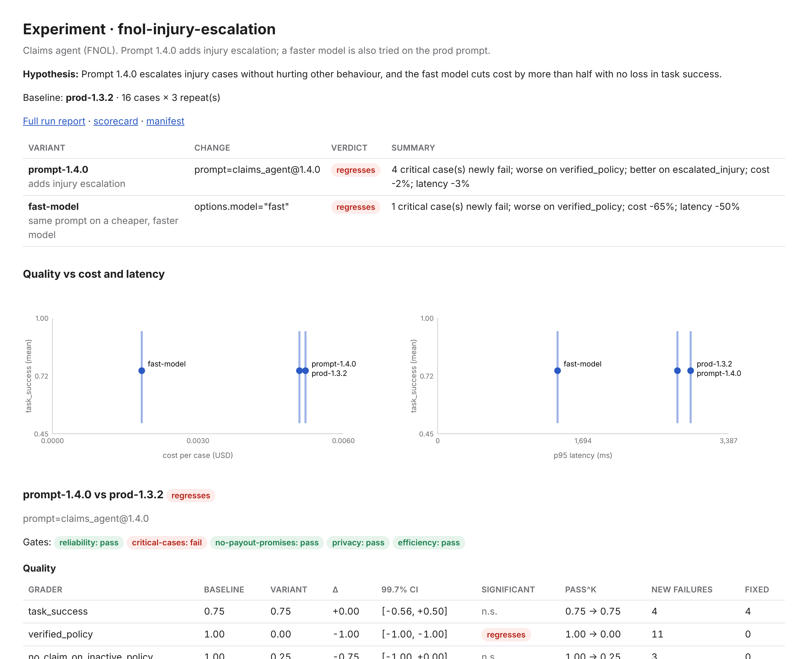

# Experiments: eval-driven iteration

An experiment answers "should we make this change?" for one or more candidate changes at once. You name a baseline
and the variants. The framework runs all of them on the same cases with the same seed, repeats and judges, then
compares each variant with the baseline:

- quality, with a confidence interval and a significance test per grader
- cost and latency
- critical cases
- which slices and failure types changed

It saves everything needed to reproduce the run.

It builds on the normal runner: a variant is the suite's own target with a small change, and every grader and gate
in the suite still applies.

## When to use what

| You want to | Use |
|---|---|
| Try several candidate changes (prompt, model, retriever, settings) and pick one | `genai-evals experiment run` |
| Gate one change in CI against what's in prod | `genai-evals run --baseline` with `delta()` gates ([gates](gates.md)), or an experiment with `--fail-on-regression` |
| Compare two runs you already have | `genai-evals compare current.json baseline.json` (same comparison report) |
| A/B two prompt versions quickly | `genai-evals prompts diff a@1 a@2 --suite suite.yaml` (also writes the comparison) |

## The experiment file

```yaml
# based on examples/insurance/fnol_experiment.yaml, which simulates the faster model with options: {model: fast}
name: fnol-injury-escalation
description: Prompt 1.4.0 adds injury escalation; a faster model is also tried on the prod prompt.
hypothesis: >-
  Prompt 1.4.0 escalates injury cases without hurting other behaviour, and the fast model cuts cost by more than
  half with no loss in task success.
suite: fnol_agent.yaml
target: fnol-agent                  # the suite target to vary (needed only if the suite has several)
baseline: {name: prod-1.3.2, prompt: claims_agent@1.3.2}
variants:
  - {name: prompt-1.4.0, prompt: claims_agent@1.4.0, description: adds injury escalation}
  - {name: fast-model, prompt: claims_agent@1.3.2, profile: bedrock-fast}   # another provider profile = another model
repeats: 3
seed: 7
alpha: 0.05
correction: bonferroni
```

| Key | Default | Meaning |
|---|---|---|
| `name`, `description`, `hypothesis` | | shown in the report; write the hypothesis *before* you run |
| `suite` | | the suite to use (relative to this file) |
| `providers` | `providers.yaml` next to the suite | provider profiles |
| `target` | the suite's only target | the target that baseline and variants change |
| `baseline` | `{name: baseline}` (the target unchanged) | a variant spec: what runs as the reference |
| `variants` | | one or more variant specs |
| `graders` | all | compare only these graders (fewer graders means fewer tests, see below) |
| `repeats`, `seed` | the suite's | override for this experiment |
| `alpha` | 0.05 | false-positive rate for the whole experiment |
| `correction` | `bonferroni` | `bonferroni` splits `alpha` across all tests; `none` uses `alpha` per test |

A **variant spec** has a `name`, an optional `description`, and the change:

| Key | Changes |
|---|---|
| `prompt` | the prompt version, e.g. `claims_agent@1.4.0` |
| `profile` | the provider profile, i.e. another model or cloud |
| `options` | merged into the target's `options` (temperature, model hints, adapter settings) |
| `retriever` | the RAG retriever settings |
| `overrides` | any other target field, e.g. `{max_steps: 8, framework: openai_agents_sdk}` |

Everything not changed is inherited from the suite's target. The report lists each variant's change against the
baseline, so reviewers see exactly what differs.

**Gates.** The suite's gates are evaluated for every variant and shown in the report. Gates that compare with a
baseline *run* (`delta()`, `significant()`) are left out, because the experiment comparison replaces them; the
report names them.

## Running it

```bash
genai-evals experiment run fnol_experiment.yaml --out out/injury-exp
genai-evals experiment run fnol_experiment.yaml --fail-on-regression    # exit 1 if any variant regresses (CI)
genai-evals experiment rerun out/injury-exp                             # reproduce it
genai-evals experiment report out/injury-exp                            # re-render the comparison
```

The default output folder is `.genai-evals/experiments/<name>/<timestamp>`:

| File | Contents |
|---|---|
| `comparison.html` / `.md` / `.json` | the side-by-side comparison (the `.md` works as a PR comment) |
| `manifest.json` | what is needed to reproduce the run (below) |
| `experiment.yaml` | a copy of the experiment file |
| `run/` | the full run: `result.json`, engineer report, scorecard, Markdown, JUnit |

## Reading the comparison



For each variant against the baseline:

- **Verdict:**
  - `regresses`: a critical case newly fails, or a grader is significantly worse and none is better
  - `trade-off`: some graders significantly better, some significantly worse
  - `improves`: significantly better, nothing worse
  - `no detectable difference`: nothing significant. This means the dataset could not detect a change, not that
    there is none; see the warning about small *n*.
- **Quality:** each grader's baseline and variant mean, Δ with its interval, significance, pass^k across repeats,
  and how many cases newly fail or were fixed.
- **Cost and latency:** cost per case, mean and p95 latency, and the relative change.
- **Critical cases:** how many pass before and after, and which newly fail or were fixed.
- **Slices that moved most:** tags ranked by how much the grader mean changed. Slices with fewer than `min_n` cases
  are listed separately and never ranked.
- **Failure types and cases:** for each grader, how many cases became failures or were fixed, and the list of cases
  that flipped, with critical cases marked.
- **Quality vs cost and latency:** every variant on one chart.

## Statistics

- **Same cases, paired.** Every variant runs on the same cases, so each comparison is paired case by case (bootstrap
  on per-case differences, McNemar for pass / fail). That needs far fewer cases than comparing two independent runs.
- **Multiple comparisons.** An experiment runs one test per variant × grader, plus cost and latency per variant. With
  `correction: bonferroni` (the default), `alpha` is split across all of them. The intervals in the report are shown
  at that stricter level, for example 99.7% for 18 tests. Comparing fewer graders (`graders:`) or fewer variants
  makes each test more sensitive.
- **Slices are exploratory.** Slice changes are not corrected for multiple comparisons. Use them to decide where to
  look and which cases to add, not as findings.
- **The other assumptions** in [statistical assumptions](gates.md#statistical-assumptions) still apply: cases must be
  exchangeable, repeats are averaged before testing, and small datasets can only detect large changes.

## Reproducibility

`manifest.json` records:

| | |
|---|---|
| Files | SHA-256 of the experiment file, suite, providers file, dataset, calibration file, and local Python modules behind targets (e.g. `insurance_targets.py`) |
| Prompts | the content hash of every prompt version used |
| Variants | the full target spec each variant ran with |
| Providers | for each profile used: provider, model id, family, region / location, options. Never auth or secrets |
| Judges | judge names, judge prompt hash, temperature, reported model ids, and a config hash per grader |
| Env vars | the *names* of the environment variables the YAML files read, never their values |
| Run | seed, repeats, number of cases, tokenisation, `on_error`, `min_n`, gates left out |
| Environment | framework version, Python version, git commit and whether the working tree had uncommitted changes |

`genai-evals experiment rerun <folder>` first checks every hash. If the experiment, suite, dataset, a prompt version
or local target code changed since the original run, it refuses with the list of changes (`--force` runs anyway).
After the run it writes `reproduction.json`: for every variant × grader, whether the new Δ falls inside the original
interval and whether significance and the verdict agree.

What a manifest can't pin:

- **Model behaviour.** A provider can change a model behind the same id, and LLM sampling is not deterministic even
  at temperature 0. A rerun reproduces within the intervals, not byte for byte.
- **Code outside the suite folder, and installed packages.** These are pinned only by the git commit and the
  framework version. `git_dirty` in the manifest records whether the working tree had uncommitted changes.
- **Environment variable values.** These include region, project and model ids that come from `${VAR}`. Keep them
  in your CI variables or `.env.example`.

Commit `manifest.json` and `comparison.md` with the change they justify, or attach them to the pull request. The
`run/` folder holds tokenised samples ([DPDP](dpdp.md)); keep it with your other eval results rather than in git.

## In CI

```yaml
- run: genai-evals experiment run evals/model-upgrade.yaml --out out/exp --fail-on-regression
- uses: actions/upload-artifact@v4
  with: {name: experiment, path: out/exp}
- run: gh pr comment "$PR" --body-file out/exp/comparison.md
```
